# SkyHotel — SkyNet Hotel Template

A responsive hotel website with online booking, a demo payment step, the **SkyHotel Circle** membership program and a full hotel admin, built for **ASP.NET Core (.NET 10)** on the **SkyNet Framework**.
Each staff member gets their own areas to manage (front desk, bookings, calendar, housekeeping, rates, offers, members and more), and the server checks and logs every action. Data is stored in JSON files, with no database.
Free and open source. **100% AI-driven coding — built by Claude.**

[](https://dotnet.microsoft.com/)
[](https://www.nuget.org/packages/TheSkyLite.SkyNet)
[](LICENSE)
[](#100-ai-driven-coding)

**Live demo:** https://www.theskylite.com/SkyHotel. Book a stay, sign in as a member, then open **Staff sign in** in the footer and pick a role.

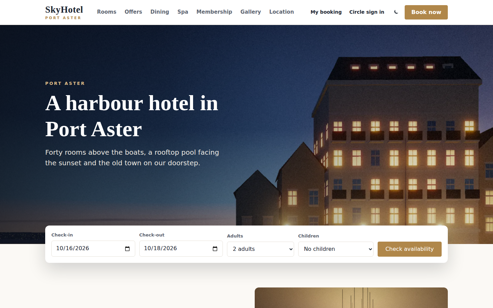

> **Fictional hotel. No real payments.** SkyHotel, Port Aster and every room, guest, member, review and price are invented. The payment step is a demo: it checks the card number format but never charges anything. The photographs are painted in code and the sample videos are made from them; there are no stock images.

---

## Features

### Hotel website (12 pages)

- **Home:**
  - a hero with a looping background video (a photo for visitors who prefer less motion) and a booking bar (dates, adults, children);
  - the welcome text, the six room types and the hotel's facilities;
  - offers and the membership band;
  - guest reviews with the average rating, and the location.
- **Rooms:** filter (harbour view, sleeps 3+, suites) and sort by price or size. **Room** pages have a photo gallery with an optional ▶ room tour video, amenities, a **five-week rate calendar** with sold-out nights, and a booking box.
- **Reservation:** four steps on one page.
  1. **Dates & room:** live availability for each room type, "Only 2 left" badges, and three rates: Flexible, Advance saver (−10%, no refund) and Bed & breakfast. Promo codes are accepted.
  2. **Your details:** filled in automatically for signed-in members.
  3. **Payment (demo):**
     - **Card checks:** card number checksum, expiry date and security code.
     - **Test cards:** `4242 4242 4242 4242` is accepted; `4000 0000 0000 0002` is always declined.
     - **Points:** members can use them here (1,000 points = $10).
  4. **Confirmed:** a booking code like `SKH-7Q4RMX`.
- **My booking:** look a booking up by code and last name.
  - **Cancel:** follows the rate rules (free until 48 hours before arrival on flexible rates; Advance saver is not refunded).
  - **Details:** check-out time (including a late check-out) and how the stay is paid (card, or at the hotel for phone and agency bookings).
  - **Review:** after check-out, the guest can leave a review.
- **Membership** and **My Circle:**
  - **Membership:** join, sign in, grades and member-only offers.
  - **My Circle:** points to spend, lifetime points, pending points, a progress bar to the next grade, upcoming and past stays, points history with paging, member promotions and the member's profile.
- **Dining, Spa, Offers, Gallery** (a lightbox for photos and videos) and **Location & contact** (directions and FAQ).
- **Light and dark theme.** Responsive layouts for desktop, tablet and phone.

### SkyHotel Circle (membership)

| Grade | Lifetime points | Room discount | Benefits |
|---|---|---|---|
| Member | from joining | 5% | member rate |
| Bronze | 1,000 | 5% | welcome drink, late checkout |
| Silver | 10,000 | 7% | welcome drink, late checkout, priority check-in |
| Gold | 100,000 | 10% | late checkout, free breakfast, upgrade when available |
| Diamond | 1,000,000 | 15% | late checkout, suite upgrade, lounge, guaranteed room |

- **Earning:** $1 spent = 1 point on rooms, dining and spa. Points are credited **at check-out**; until then they show as pending.
- **Spending:** 1,000 points = $10 off a stay, up to half the room price. Spending lowers the balance, never the grade.
- **Offers:** members-only promo codes, and bonus codes that double or triple the points a stay earns.

### Hotel admin (18 pages)

- **Sign in** with your own password (PBKDF2). Failed attempts are throttled.
- **Dashboard:**
  - **Today:** arrivals, departures, rooms in house and occupancy tonight.
  - **This month:** room revenue, average daily rate, new members and points earned.
  - **Lists:** who arrives and leaves today, rooms not ready, reviews waiting and recent activity.
- **Check-in / Check-out:** Arrivals, In house and Departures tabs, with a date picker, search, room-type filter and paging.
  - **Check in:** pick a free room of the booked type. Only rooms that are Clean or Inspected can be used. The list shows each booking's promo code under the booking code.
  - **Promotion check:** the check-in popup shows the booking's promotion and whether it is valid for the room type. If not, the desk can honor the discount or remove it (the amount goes back on the bill).
  - **Guest details:** phone, address, country, passport no., car plate and valet ticket number, editable at check-in and in the folio. A passport no. is required for guests from outside the hotel's country; it is masked everywhere else (•••• 1829).
  - **Payment before check-in:** a payment step takes any balance due (pay-at-front bookings) by card on file, card at the desk (demo) or cash, plus the security deposit (card hold or cash). The room turns **Occupied**.
  - **Late check-out:** standard is 11:00; the desk can set any time up to 15:00. Bronze members and above show a "Late checkout eligible" badge with their grade, and late times show in the In house and Departures lists. A "Late checkout" extra is available if you charge for it.
  - **Check out:** the bill (stay, extras, tax, paid, balance). Add charges such as minibar, dinner or parking, and confirm in a popup. The deposit covers extras first and the rest is released; anything above it is taken by card or cash.
  - **Points at check-out:** the member's points are credited and their grade is updated. The room turns Dirty for housekeeping.
- **Bookings:**
  - **List:** search (code, guest, email, phone or agency), filters for status, room type and source, sort, a check-in period and paging. Shows each guest's phone under their name.
  - **New phone or agency booking:** find a guest or member (name, email, phone or member no.) or enter a new guest, pick the stay, pick a promo code from the list of offers that fit the room type, dates and guest (changing the room type clears it), check the price and book. These pay at the front desk: nothing is charged up front and the full amount is due at check-out.
  - **Booking detail:** guest, stay, price breakdown, payment, extras and staff notes.
  - **Actions:** change dates, guests or room type (with a price check), mark a no-show, or cancel with the rate rules or a waived fee.
- **Calendar:** three views.
  - **Month and Week:** each day shows arrivals, guests staying that night, departures and occupancy. Tap a number for a popup list with a Booked / Checked in / Checked out badge, sorted by arrival date then expected arrival time; tap a guest to open the booking. Week lists up to five arrivals by name.
  - **Day:** rooms × 14 days, with booking bars by status and blocked dates. A list shows bookings that have no room yet; give them a room or move them.
- **Housekeeping:** Clean / Inspected / Dirty / Out of order for every room, with today's arrivals and departures, filters and paging. Check-in marks the room Occupied (locked for housekeeping) and check-out marks it Dirty. Opens on Dirty rooms.
- **Rooms & Rates:**
  - **Room types:** name, beds, size, weekday and weekend rates, photos and a room video from the media library, amenities, and a 14-night price preview.
  - **Rooms:** add or edit rooms. Deleting a room is refused if it has guests coming or would overbook its type.
  - **Seasons:** percentage price changes for date ranges.
  - **Blocked dates:** take a room out of sale.
- **Offers:** promo codes with discount, bonus points, minimum nights, valid dates, members-only, on/off, room types (all or specific types) and a picture from the media library. A code is refused for room types it doesn't cover, online and at the desk.
- **Members:**
  - **List:** grade counts, then search, grade filter, sort, a joined period and paging.
  - **Add member:** sign up a guest at the desk. A past guest keeps their stays; a temporary password is shown once for their first sign-in.
  - **Member detail:** profile, grade progress, stays and points history, and **Adjust points** with a reason.
  - **Points history tab:** every point entry for all members.
- **Guests:** everyone who has booked, with stays, nights, money spent and latest stay, VIP flag and notes.
- **Reviews:** Waiting / Published / Hidden, filter by rating, search and period. Publish, hide, reply or delete.
- **Content:** edit the text and pictures of the home hero, welcome, dining, spa, location and membership blocks, pick the home background video, and choose the gallery photos and videos.
- **Media library:** every photo and video the website can use. Rooms, Offers and Content pick from it.
  - **Upload a photo:** JPG, PNG or WebP, resized in the browser to 1600 px with a 640 px preview. The server checks the file really is an image.
  - **Upload a video:** MP4 or WebM up to 50 MB (20 MB in the demo), sent in 2 MB parts with a progress bar. The poster image is taken from the first second.
  - **Library:** All / Photos / Videos, search, added by, a period filter and paging. Open any item to preview it and see where it is used. Rename, or delete items that are not in use.
- **Reports:**
  - **Periods:** Today, This week (Sunday to Saturday), Last 7 days, Last 30 days, This month, Next 30 days or any date range.
  - **Figures:** occupancy, ADR, RevPAR, room revenue, bookings made, average stay, member share of room nights, and points earned vs. used.
  - **Charts and tables:** a nightly occupancy chart, plus tables by room type and by source.
- **Activity log:** every action with who, what and when; refused attempts are highlighted. Filters for period (Today by default), person, search and outcome, with paging.
- **Users:** a permission matrix for each person, with a right (None / View / Edit) for every area plus three extra rights.
- **Settings:** name, contact details, accent colour, theme, tax, check-in and check-out times, cancellation window, breakfast price, security deposit and hotel country.
- **My account:** your name, your password and a summary of your rights.

Every list in the admin has paging, a search box with suggestions as you type, dropdown filters, and a period filter where dates matter.

### Permissions

| Area | Rights | Extra right |
|---|---|---|
| Check-in / Check-out | View, Edit | |
| Bookings | View, Edit | **Cancel & refund** |
| Calendar | View, Edit (give or move rooms) | |
| Housekeeping | View, Edit | |
| Rooms & Rates | View, Edit | **Block dates** |
| Offers, Guests, Reviews, Content | View, Edit | |
| Media library | View, Edit (upload, rename, delete) | |
| Members | View, Edit | **Adjust points** |
| Reports, Activity log | View | |
| Users, Settings | general managers only | |

- The menu shows only the areas a person can see.
- Every check runs on the server. A request the user isn't allowed to make is refused and written to the activity log, even if someone crafts it by hand.
- Everyone can see their own activity.

### Live demo mode

With `app.app.runmode | 0` the sign-in page lists the staff. Everyone signs in with the password `demo`.

| User | Role | Can manage |
|---|---|---|
| **elena** | General Manager | everything, plus users and settings |
| **marco** | Front Desk | check-in/out, bookings (edit), guests (edit); calendar and housekeeping (view) |
| **aiko** | Reservations | bookings (edit + cancel & refund), calendar (edit), guests (edit) |
| **omar** | Revenue | rooms & rates (edit + block dates), offers (edit), media library (edit), reports |
| **lucia** | Guest Relations | reviews, content and media library (edit), guests and members (view) |
| **ben** | Housekeeping | housekeeping (edit), calendar (view) |
| **dana** | Loyalty | members (edit + adjust points), offers (edit), reports |

- **Demo member:** `mia@example.com` / `demo`, a Gold member with points history and an upcoming stay.
- **Private copy:** each visitor gets their own copy of the hotel for one hour. A booking made on the website shows up in the admin straight away, ready to check in and out.
- **Dates:** stays, seasons and offers move forward every day, so the hotel always has guests arriving today.

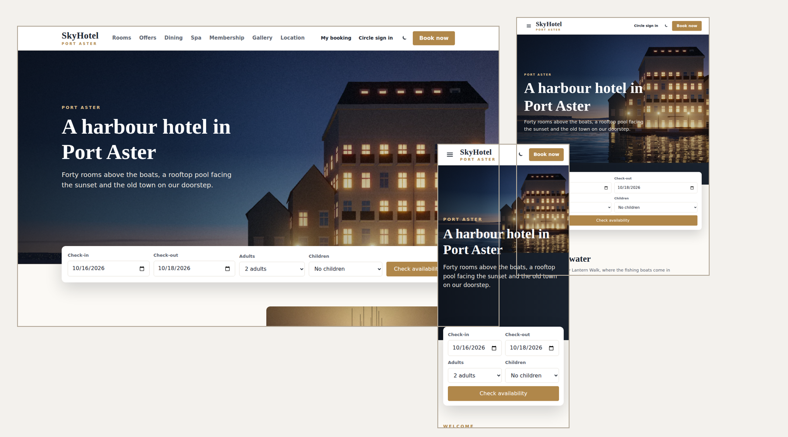

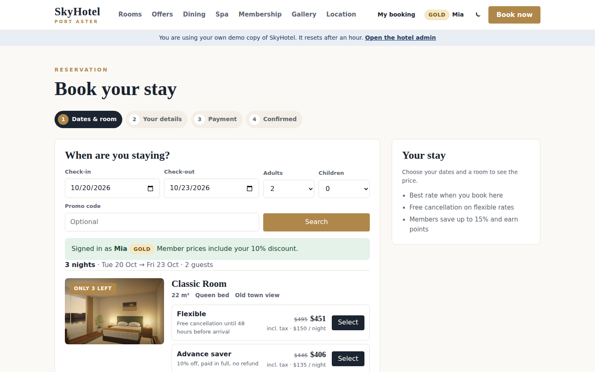

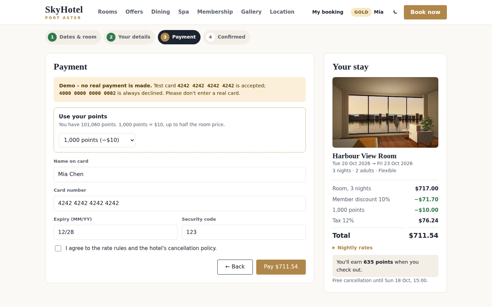

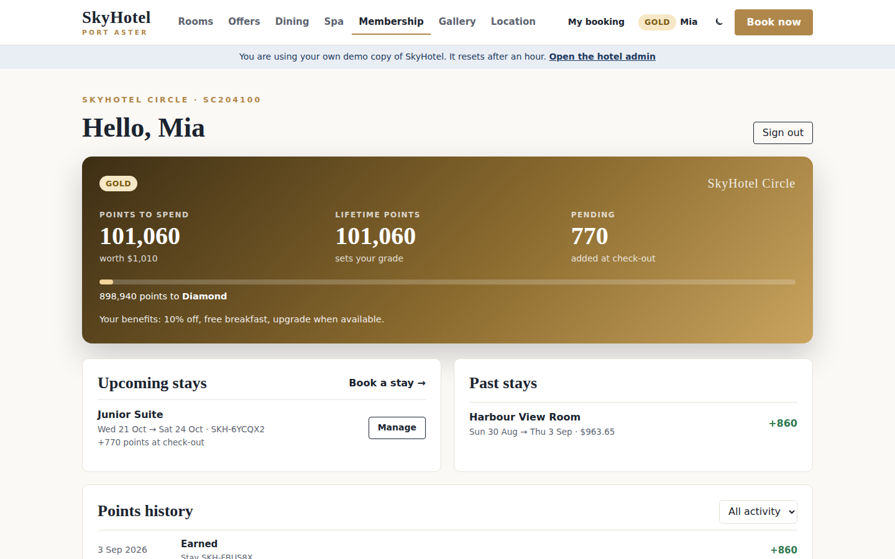

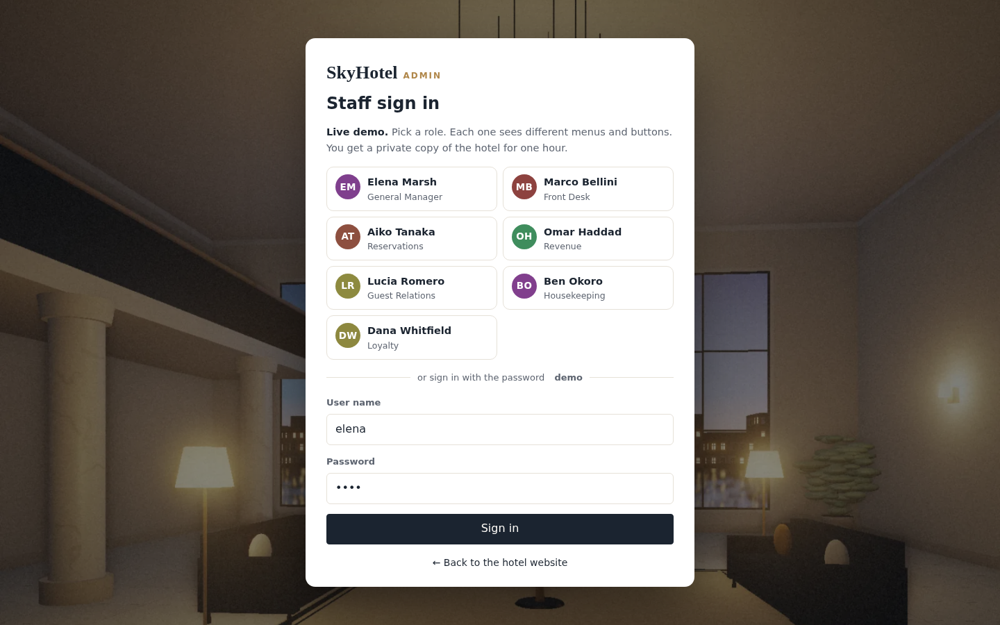

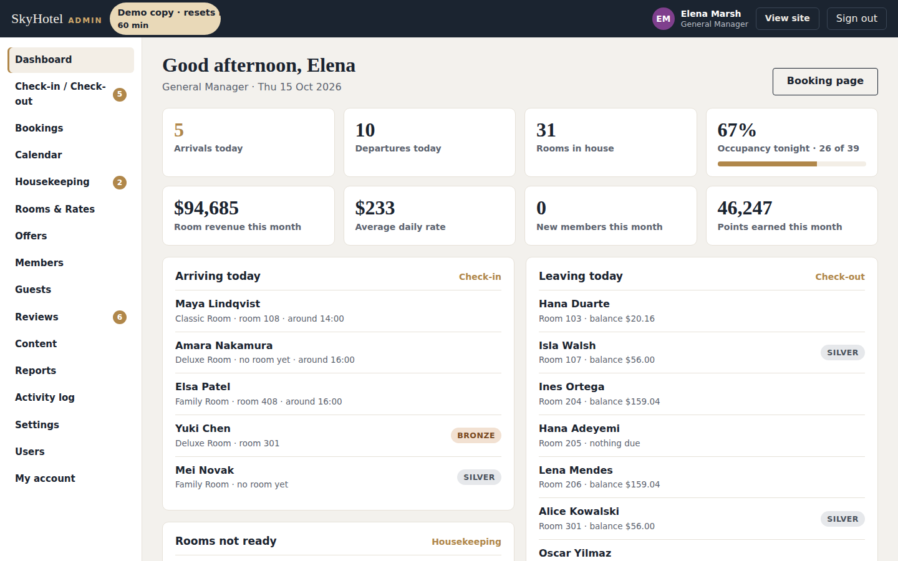

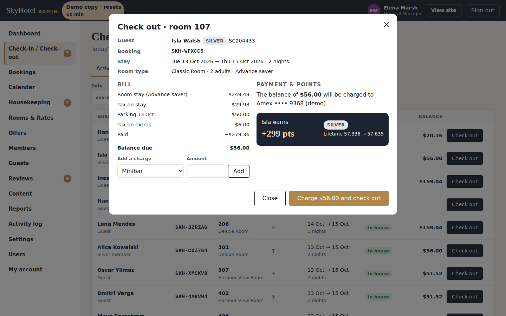

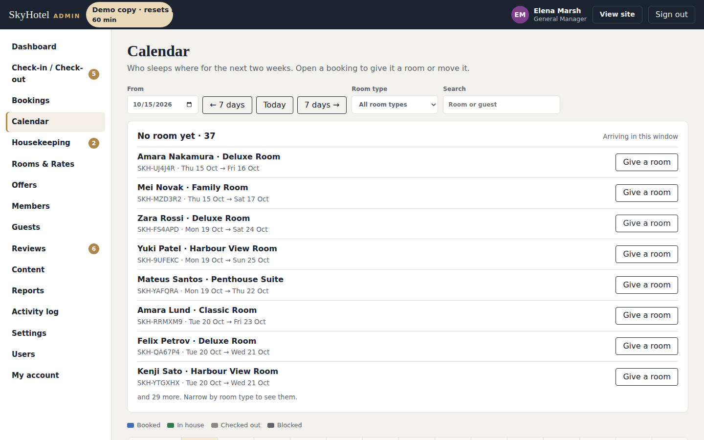

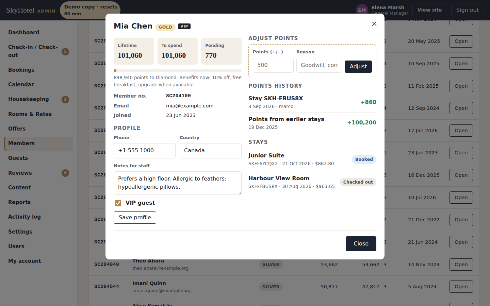

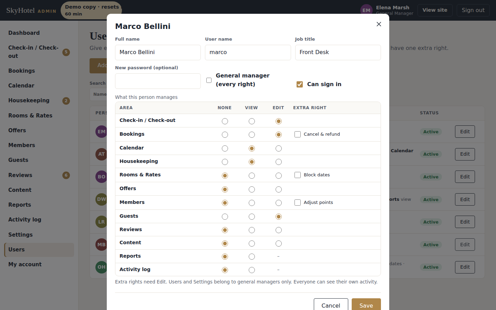

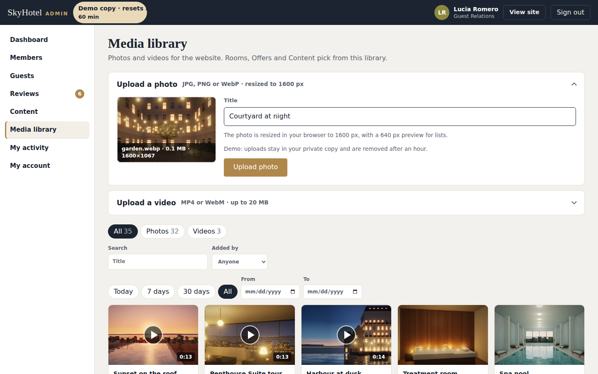

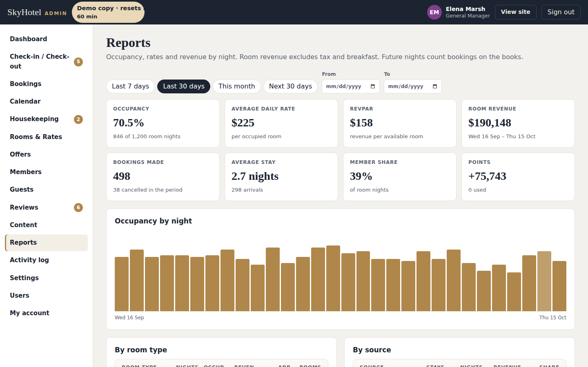

- **Painted photographs:** 32 hotel "photos" (exterior at dusk, lobby, every room type, restaurant, bar, spa, rooftop pool, harbour and old town), rendered in code by Claude as 64 WebP files.
- **No front-end build:** plain HTML, CSS and vanilla JavaScript; no npm, bundler or SPA framework.
- **No database:** everything lives in three JSON files under `data/`.

---

## Getting started

**Requirements:** .NET 10 SDK and Visual Studio (or any editor with the `dotnet` CLI).

```bash
git clone https://github.com/hkim6000/SkyNet-SkyHotelWebsite-Asp.net.Core-Full-Source.git
cd SkyNet-SkyHotelWebsite-Asp.net.Core-Full-Source
dotnet run
```

Or open `SkyHotel.csproj` in Visual Studio and press **F5**.
The SkyNet package (`TheSkyLite.SkyNet` 1.0.6) restores automatically from NuGet.
The app opens on **Home**, the startup page set in `appConfig/application.cfg`.

**Admin:** click **Staff sign in** in the footer (or open `/AdminLogin`) and pick a role.

---

## Run it for real (production mode)

1. **Create a password hash** for the first general manager. In PowerShell:

   ```powershell
   $p = Read-Host "Password"; [BitConverter]::ToString([Security.Cryptography.SHA256]::Create().ComputeHash([Text.Encoding]::UTF8.GetBytes($p))).Replace("-","").ToLower()
   ```

2. **Edit `appConfig/application.cfg`:**

   ```
   app.app.runmode | 1
   app.admin.user | elena
   app.admin.passhash | <the 64-character hash>
   ```

3. **Sign in as that user.** They become general manager. Open **Users** and set a real password for each person who needs access.
   - The sample staff are demo accounts and can't sign in until you set a new password.
   - Turn off the accounts you don't need, or rename them.

4. **Give the site write access** to three folders. On IIS, grant the application pool identity (for example `IIS AppPool\SkyHotel`) **Modify** permission on:

   | Folder | What is written |
   |---|---|
   | `data/` | `site.json`, `staff.json`, `activity.json` |
   | `temp/` | staff and member sessions (`temp/admin`), demo copies (`temp/sandbox`) and video parts while uploading (`temp/uploads`) |
| `images/uploads/` | photos and videos uploaded in the Media library (`images/uploads/live`) |

5. **Use HTTPS.** Session tokens travel in cookies and in each request.

6. **Connect a real payment provider.** The payment step in `codes/Reservation.cs` (`Pay`) only checks the card format and stores the brand and last four digits. For a live hotel:
   - Replace it with your provider's hosted payment page or tokenised card form.
   - Never send or store full card numbers on your own server.

> **Redeploying:** publishing copies the files in `data/` from your project over the live ones. Download the live `data/` folder first (or exclude it from the publish) so you keep your bookings and members. `temp/` and `images/uploads/` are not published, but turn off "Remove additional files at destination" so they are not deleted.

In production, staff and member sessions last 8 hours and renew while you work. Changing a staff password signs that person out everywhere.

---

## Project structure

```
SkyHotel/
├── appConfig/application.cfg        app settings, run mode, first general manager
├── codes/
│   ├── Models/HotelModel.cs         data DTOs (RoomType, HotelRoom, Booking, Guest, PointEntry, Offer, ...)
│   ├── Core/Store.cs                JSON storage, demo copies, date shifting
│   ├── Core/Access.cs               areas and rights, passwords, card checks
│   ├── Core/Auth.cs                 staff and member sessions, admin menu
│   ├── Core/Book.cs                 availability, prices, refunds, points
│   ├── Core/Ui.cs                   shared HTML helpers, grades, period filter, paging
│   ├── Home.cs  Rooms.cs  Room.cs  Reservation.cs  MyBooking.cs  Membership.cs  MyCircle.cs
│   │   Dining.cs  Spa.cs  Offers.cs  Gallery.cs  Contact.cs
│   └── AdminLogin.cs  Admin.cs  AdminFrontDesk.cs  AdminBookings.cs  AdminCalendar.cs
│       AdminHousekeeping.cs  AdminRooms.cs  AdminOffers.cs  AdminMembers.cs  AdminGuests.cs
│       AdminReviews.cs  AdminContent.cs  AdminReports.cs  AdminActivity.cs  AdminUsers.cs
│       AdminMedia.cs  AdminSettings.cs  AdminAccount.cs
├── htmls/  scripts/  styles/        page markup, JavaScript and CSS
├── data/
│   ├── site.json                    settings, rooms, rates, bookings, guests, members, points, reviews, content
│   ├── staff.json                   users, password hashes and rights
│   └── activity.json                the activity log (latest 5,000)
├── images/hotel/full/  hotel/thumbs/  painted photos (1600 px and 640 px, WebP)
├── images/hotel/video/              sample videos (MP4) and their posters
├── images/uploads/                  Media library uploads (demo copies in uploads/sandbox, live in uploads/live)
├── temp/                            sessions and demo copies (created at run time)
└── Program.cs
```

### One page = four files, one name

| File | Holds |
|---|---|
| `codes/AdminFrontDesk.cs` | the page class (`: WebPage`) and its server methods |
| `htmls/AdminFrontDesk.html` | markup with `{plhd_*}` placeholders |
| `scripts/AdminFrontDesk.js` | one IIFE namespace, `AdminFrontDeskJs` |
| `styles/AdminFrontDesk.css` | styles, every class prefixed (`fd-`) |

---

## SkyNet in action

The browser calls a C# method, the method returns an `ApiResponse`, and only those parts of the page change.

```js
// scripts/AdminFrontDesk.js
api('CheckOut', [{ key: 'bid', vlu: id }]);
```

```csharp
// codes/AdminFrontDesk.cs
if (!Access.Can(c.U, AreaKey, 'E'))
{
    return await Refuse(response, c, "check-out", id, "You can view folios but not check guests out.");
}
...
pts = Book.EarnOnStay(b);
Book.AddPoints(site, g, pts, "earn", b.Code, "Stay " + b.Code, c.U.Id);
...
response.SetElementContents("fd-mbody", "...+" + Ui.Num(pts) + " pts...");
```

| Page | Requests |
|---|---|
| every public page | `Hydrate` (the visitor's demo copy), `Who` (member name in the header) |
| Reservation | `Find`, `Pick`, `Details`, `Points`, `Pay`, `MemberIn` |
| MyBooking | `Lookup`, `Cancel`, `Review` |
| Membership / MyCircle | `SignIn`, `Join` / `Load`, `Hist`, `Profile`, `SignOut` |
| AdminFrontDesk | `List`, `InForm`, `CheckIn`, `Details`, `OutForm`, `Charge`, `CheckOut` |
| AdminBookings | `List`, `Open`, `Note`, `EditForm`, `Change`, `NewForm`, `FindGuest`, `NewPrice`, `Create`, `Cancel`, `NoShow` |
| AdminCalendar | `List`, `DayList`, `Open`, `Assign` |
| AdminHousekeeping | `List`, `SetStatus` |
| AdminRooms / AdminOffers | `List`, `Form`, `Save`, `Remove` |
| AdminMembers | `List`, `Open`, `Adjust`, `AddForm`, `AddMember`, `SaveMember` |
| AdminGuests / AdminReviews | `List`, `Open`, `SaveGuest` / `List`, `Act` |
| AdminContent | `Block`, `Save`, `SaveGallery` |
| AdminMedia | `List`, `Open`, `Upload`, `Chunk`, `VideoDone`, `Rename`, `Remove` |
| AdminReports / AdminActivity | `Run` / `List` |
| AdminUsers / AdminSettings / AdminAccount | `List`, `Form`, `Save` / `Save` / `Save` |

Learn more: [SkyNet Developer Guide](https://www.theskylite.com/documents/SkyNet_Developer_Guide.html)

---

## Customize it

- **In the admin:** room types, rooms, rates, seasons, offers, content, gallery, photos and videos, users, rights and settings. No code needed.
- **Starting content:** replace the three files in `data/` to ship your own defaults.
- **Grades and points:** `Ui.Grades` in `codes/Core/Ui.cs` (names, thresholds, discounts, benefits) and `Book.Price` / `Book.EarnOnStay` in `codes/Core/Book.cs`.
- **Fonts and colours:** the CSS variables at the top of each stylesheet (`--hm-head`, `--hm-text`, `--hm-ink`, ...). The accent colour comes from Settings.

> Nothing is emailed: confirmations show on screen and in My booking. Contact details are shown on the Location page.

---

## 100% AI-driven coding

Every file in this template was generated by Claude (Anthropic's AI) from short instructions, directed and reviewed by the author: C#, HTML, CSS, JavaScript, the painted photographs and the data.
No line was written by hand.

| | |
|---|---|
| Pages | 30 (12 public, 18 admin) |
| Lines of code | ~30,000 (C#, HTML, CSS, JavaScript) |
| Images | 32 painted photos (64 WebP) and 3 short videos |
| Rooms / room types | 40 / 6 |
| Sample data | 260 guests, 60 members, about 1,050 bookings, 44 reviews |
| Lines written by hand | 0 |

SkyNet's page model is small and predictable: one class, four files, `$ApiRequest` → `ApiResponse`.
With so few, consistent rules, AI can generate complete, working pages with very few errors.

---

## License

- **This template** (all source files, artwork and data in this repository): [MIT License](LICENSE). Free to use, modify and redistribute, including commercially.
- **SkyNet Framework** (`TheSkyLite.SkyNet` NuGet package): proprietary, free to use including commercial use; see the license included in the package.

---

## Links

- Live demo: https://www.theskylite.com/SkyHotel
- SkyNet Framework: https://www.theskylite.com
- NuGet package: https://www.nuget.org/packages/TheSkyLite.SkyNet
- SkyNet Agent (build your own site with Claude Code): https://github.com/hkim6000/SkyNet-Agent
- Template #1 — Beauty store: https://github.com/hkim6000/SkyNet-BeautyWebsite-Asp.net.Core-Full-Source
- Template #2 — Pharma company: https://github.com/hkim6000/SkyNet-PharmaWebsite-Asp.net.Core-Full-Source
- Template #3 — Travel blog: https://github.com/hkim6000/SkyNet-TravelWebsite-Asp.net.Core-Full-Source
- Template #4 — Fast food restaurant: https://github.com/hkim6000/SkyNet-FastFoodWebsite-Asp.net.Core-Full-Source
- Template #5 — Fine dining restaurant: https://github.com/hkim6000/SkyNet-FineDiningWebsite-Asp.net.Core-Full-Source
- Template #6 — Car dealership: https://github.com/hkim6000/SkyNet-CarDealerWebsite-Asp.net.Core-Full-Source
- Template #7 — Web comic: https://github.com/hkim6000/SkyNet-WebComicWebsite-Asp.net.Core-Full-Source
- Template #8 — Art gallery: https://github.com/hkim6000/SkyNet-ArtGalleryWebsite-Asp.net.Core-Full-Source
- Template #9 — Artist blog: https://github.com/hkim6000/SkyNet-ArtistBlogWebsite-Asp.net.Core-Full-Source
- Template #10 — Newspaper: https://github.com/hkim6000/SkyNet-SkyLitePostWebsite-Asp.net.Core-Full-Source
- SkyNet project template: https://github.com/hkim6000/ASPNETCoreEmpty.SkyNet

© 2026 HC Kim
